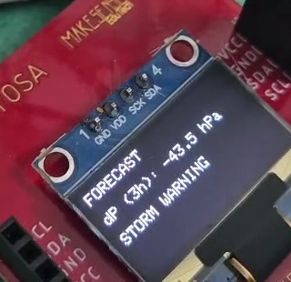
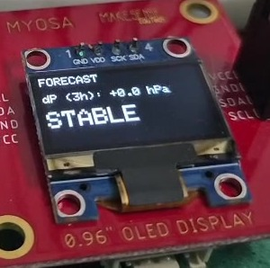
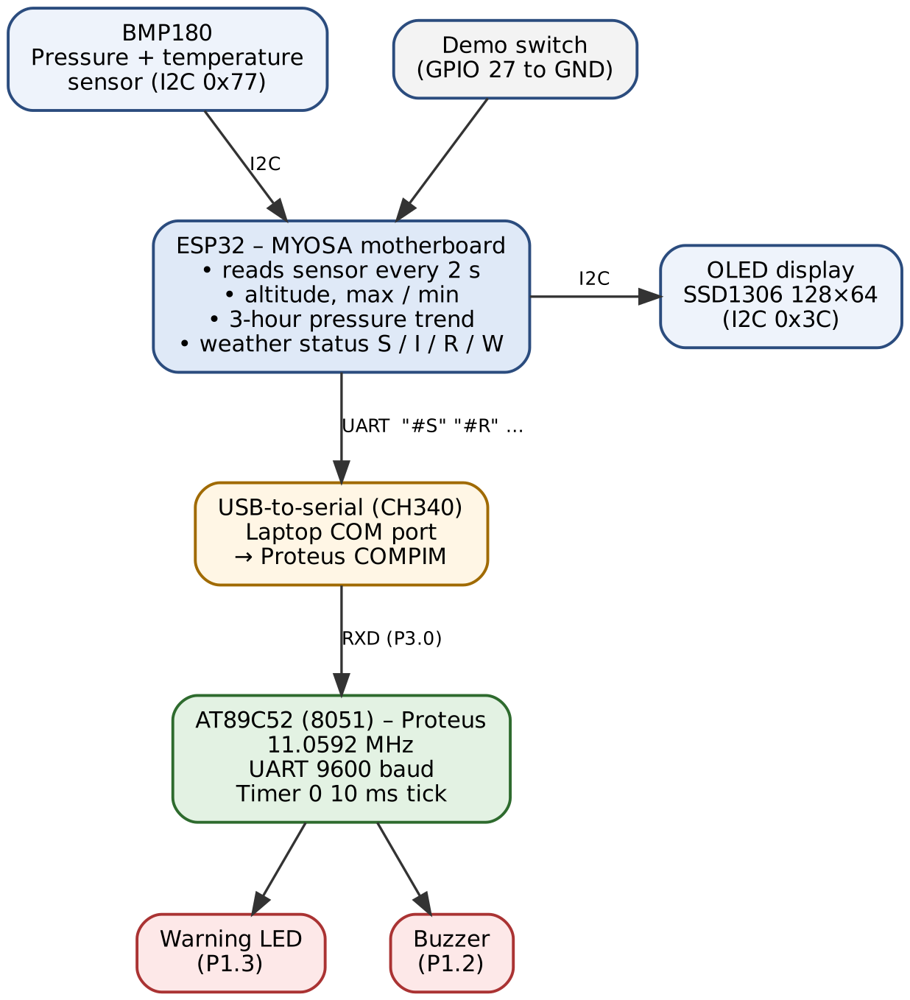
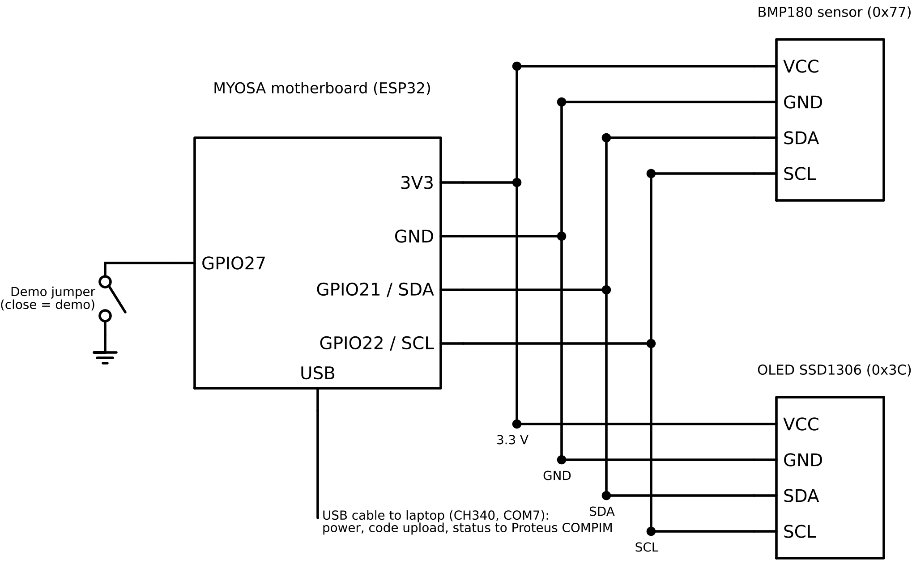
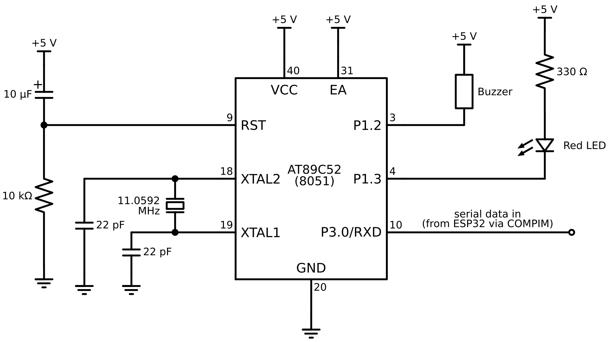

# Mini Weather Station – 8051 + MYOSA (ESP32)

A pressure-based rain and storm alert system. An ESP32 on the IEEE **MYOSA** sensor kit reads a BMP180 barometer, tracks how the pressure changes over 3 hours, and shows readings and a forecast on an OLED. It sends the weather status over UART to an **8051 (AT89C52)**, which drives a warning LED and buzzer. The 8051 is simulated in Proteus and linked live to the real hardware through the PC's COM port.

Embedded Systems mini project, B.Tech ECE, School of Engineering, CUSAT.

<p align="center">
  
  
</p>

## How it works

| Pressure change in 3 h | Status | OLED | 8051 output |
|---|---|---|---|
| between −1.0 and +1.0 hPa | `#S` Stable | STABLE | LED off |
| rise ≥ 1.0 hPa | `#I` Improving | IMPROVING | LED off |
| fall ≥ 1.0 hPa | `#R` Rain likely | RAIN LIKELY | LED steady on |
| fall ≥ 3.0 hPa | `#W` Storm warning | STORM WARNING | LED blinks, buzzer 10 s |
| no message for 5 s | link lost | – | LED blinks fast |

- The ESP32 reads temperature and pressure every 2 s, calculates altitude and max/min, and stores one pressure sample every 10 min in an 18-slot ring buffer (3 hours).
- The status is sent every 2 s as `#` + letter + newline at **9600 baud, 8N1**.
- The 8051 receives it with its built-in UART (P3.0/RXD) and serial interrupt. Timer 1 generates 9600 baud from an 11.0592 MHz crystal (TH1 = FDh), and Timer 0 gives a 10 ms tick.
- **Demo mode:** connect GPIO 27 to GND, and the pressure falls 0.1 hPa every 2 s, so RAIN LIKELY appears after about 20 s and STORM WARNING after about 60 s.



## Hardware

| Part | Connection |
|---|---|
| MYOSA motherboard (ESP32) | USB to PC (CH340) |
| BMP180 sensor board | I2C: SDA GPIO 21, SCL GPIO 22 (address 0x77) |
| SSD1306 OLED 128×64 | same I2C bus (address 0x3C) |
| Demo jumper | GPIO 27 → GND |
| AT89C52 (Proteus) | P3.0/RXD ← COMPIM, LED on P1.3, buzzer on P1.2 (active-low) |




## Project structure

```
├── platformio.ini          # ESP32 build settings and libraries
├── src/main.cpp            # ESP32 program (sensing, forecast, OLED, UART)
├── 8051/weather_8051.c     # 8051 program (UART receive, LED and buzzer alarm)
├── 8051/build/             # compiled weather_8051.hex
├── .vscode/tasks.json      # Ctrl+Shift+B builds the 8051 HEX with SDCC
└── docs/                   # report, presentation and images
```

## Build and run

**ESP32:** open the folder in VS Code with the PlatformIO extension, then Build → Upload → Serial Monitor (9600 baud). The libraries (Adafruit BMP085, SSD1306, GFX) download automatically.

**8051:** install [SDCC](https://sdcc.sourceforge.net) and press **Ctrl+Shift+B** to build `8051/build/weather_8051.hex`. If SDCC is installed somewhere else, change the `command` path in `.vscode/tasks.json`.

**Proteus:**
1. Load the HEX file into an AT89C52 and set the clock to **11.0592 MHz**.
2. Connect a COMPIM block (your ESP32's COM port, 9600 baud) to P3.0/RXD.
3. Close the serial monitor and run the simulation.

## Documents

- [Project report (PDF)](docs/Project_Report.pdf)
- [Presentation (PPTX)](docs/Presentation.pptx)

## Team

Anoof Muhammed K · Bhagath TP · Dania Abdulla · Gautham Laser · Ivana Anto
